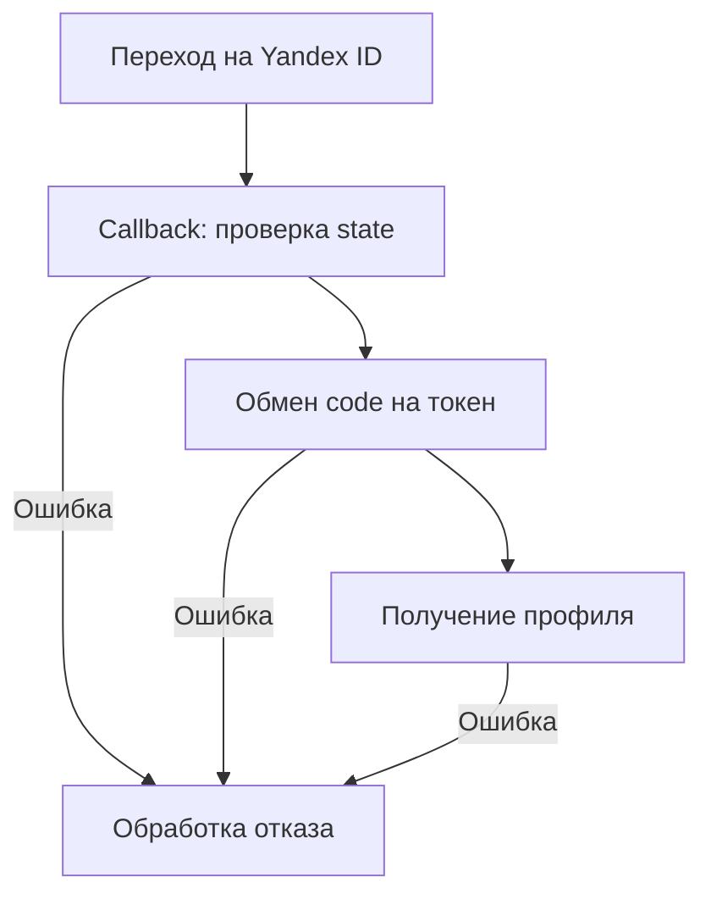

# OAuth2 Yandex

[](https://github.com/yaleksandr89/oauth2-yandex)
[](https://github.com/yaleksandr89/oauth2-yandex/actions/workflows/ci.yml)
[](https://packagist.org/packages/yaleksandr89/oauth2-yandex)
[](https://packagist.org/packages/yaleksandr89/oauth2-yandex)
[](https://www.php.net/)
[](https://oauth2-client.thephpleague.com/)
[](LICENSE)


## Выберите язык

| Русский | English | Español | 中文 | Français | Deutsch |
|---|---|---|---|---|---|
| **Выбран** | [English](docs/langs/en/README.md) | [Español](docs/langs/es/README.md) | [中文](docs/langs/zh/README.md) | [Français](docs/langs/fr/README.md) | [Deutsch](docs/langs/de/README.md) |

`yaleksandr89/oauth2-yandex` — provider-клиент Yandex ID для
[`league/oauth2-client`](https://oauth2-client.thephpleague.com/).

Пакет поддерживает OAuth 2.0 Authorization Code Flow, получение и обновление токенов,
а также получение профиля пользователя через API Yandex ID.

## Перед началом

Перед подключением пакета зарегистрируйте OAuth-приложение, настройте Redirect URI
и выберите необходимые права:

[Регистрация приложения в Яндекс OAuth](docs/langs/ru/guides/yandex-oauth-application.md)

## Установка

```bash
composer require yaleksandr89/oauth2-yandex
```

## Конфигурация

```php
<?php

use Yaleksandr\OAuth2\Client\Provider\Yandex;

$provider = new Yandex([
    'clientId' => 'fake-yandex-client-id',
    'clientSecret' => 'fake-yandex-client-secret',
    'redirectUri' => 'https://example.com/oauth/yandex/callback',
]);
```

Храните `Client ID` и `Client Secret` в конфигурации или переменных окружения.
Не добавляйте `Client Secret` в репозиторий.

## Как работает OAuth2 Yandex



В сценарии Authorization Code Flow с PKCE приложение инициирует авторизацию, сохраняет `state` и PKCE verifier, проверяет `state` при возврате пользователя и восстанавливает verifier перед обменом кода. Provider `Yandex` использует `league/oauth2-client` для получения токена и передаёт его в заголовке `Authorization: OAuth` при запросе профиля. `YandexResourceOwner` предоставляет типизированные данные; создание локальной сессии и обработка ошибок остаются ответственностью приложения.

## Использование

Полный нативный пример показывает redirect на Yandex, проверку `state`, PKCE,
обработку callback, получение профиля, дополнительные параметры авторизации
и обновление токена:

[Нативное использование с `league/oauth2-client`](docs/langs/ru/guides/native-usage.md)

## Symfony и KnpUOAuth2ClientBundle

Для Symfony пакет подключается как generic provider через
`knpuniversity/oauth2-client-bundle`. Отдельная инструкция включает конфигурацию
клиента, запуск авторизации, получение токена и профиля:

[Интеграция с Symfony и KnpUOAuth2ClientBundle](docs/langs/ru/integrations/symfony-knpu-oauth2-client-bundle.md)

## Доступные методы

Подробный справочник описывает публичные методы `Yandex`,
`YandexResourceOwner`, `YandexAvatar`, `YandexPhone`, а также enum-типы
`YandexSex` и `YandexAvatarSize`:

[Справочник публичного API](docs/langs/ru/reference/api.md)

## Размеры аватара

Размеры `YandexAvatarSize` соответствуют
[документации Yandex ID о данных пользователя](https://yandex.com/dev/id/doc/ru/user-information).

| PHP case | Значение Yandex | Размер |
|---|---|---|
| `Size28` | `islands-small` | 28×28 |
| `Size34` | `islands-34` | 34×34 |
| `Size42` | `islands-middle` | 42×42 |
| `Size50` | `islands-50` | 50×50 |
| `Size56` | `islands-retina-small` | 56×56 |
| `Size68` | `islands-68` | 68×68 |
| `Size75` | `islands-75` | 75×75 |
| `Size84` | `islands-retina-middle` | 84×84 |
| `Size100` | `islands-retina-50` | 100×100 |
| `Size200` | `islands-200` | 200×200 |

`islands-*` — служебные значения размера, которые Yandex использует в URL CDN
аватаров; PHP cases названы по фактическому размеру изображения.

## Пример профиля

<details>
<summary>Показать структуру ответа Yandex ID</summary>

`YandexResourceOwner::toArray()` возвращает исходную структуру ответа.
Ниже использованы вымышленные данные:

```json
{
  "id": "100000000000000",
  "login": "ivan.petrov",
  "client_id": "0123456789abcdef0123456789abcdef",
  "display_name": "Иван Петров",
  "real_name": "Иван Петров",
  "first_name": "Иван",
  "last_name": "Петров",
  "sex": "male",
  "default_email": "ivan.petrov@example.com",
  "emails": ["ivan.petrov@example.com"],
  "birthday": "0000-12-23",
  "default_avatar_id": "12345/example-avatar-id",
  "is_avatar_empty": false,
  "default_phone": {
    "id": 12345678,
    "number": "+79001234567"
  },
  "psuid": "1.ABCdef.example-user-specific-id"
}
```

Состав ответа зависит от прав, выданных приложению. Дата рождения остаётся строкой
и может содержать неизвестные компоненты, например `0000-12-23`.

</details>

---

<p align="center">
  Если библиотека помогла решить задачу, поставьте звезду на GitHub — так проект будет
проще найти другим разработчикам. 🤘
</p>
